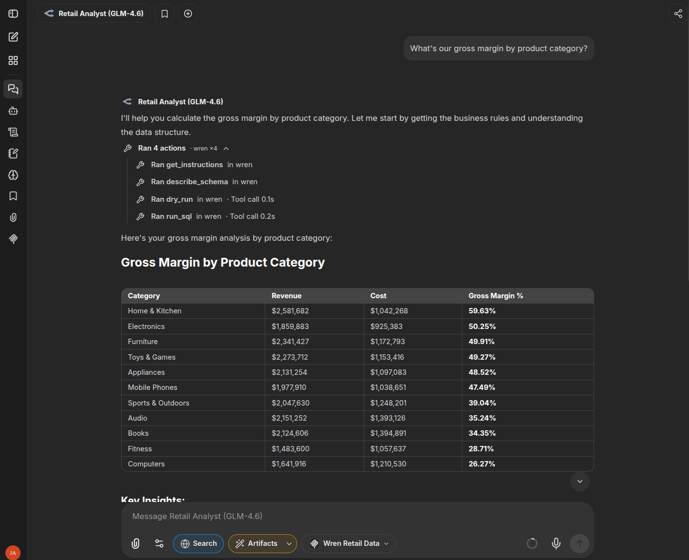
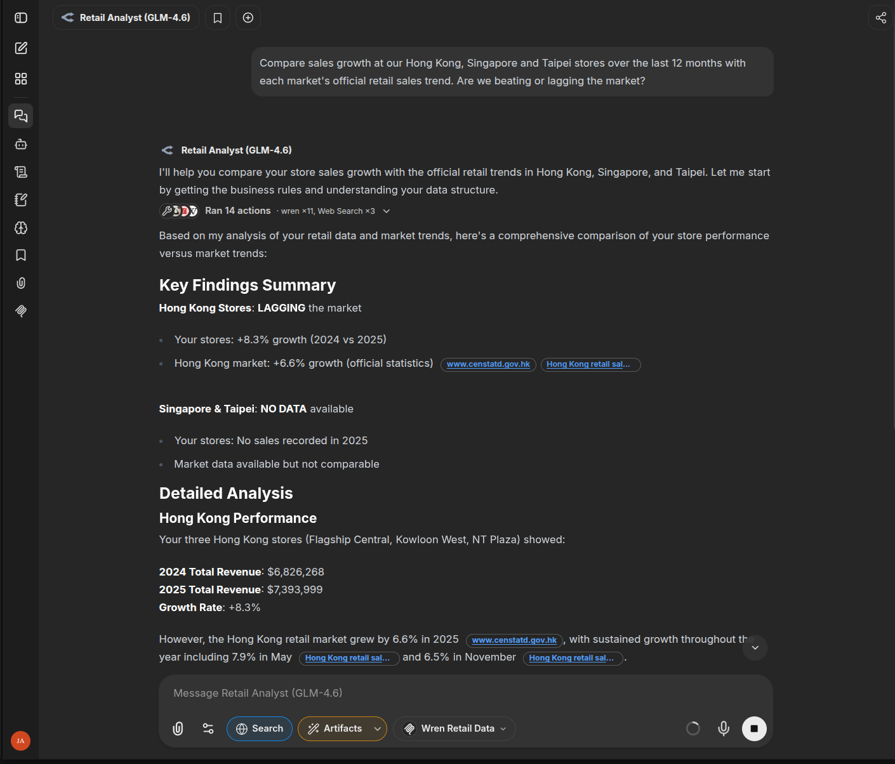
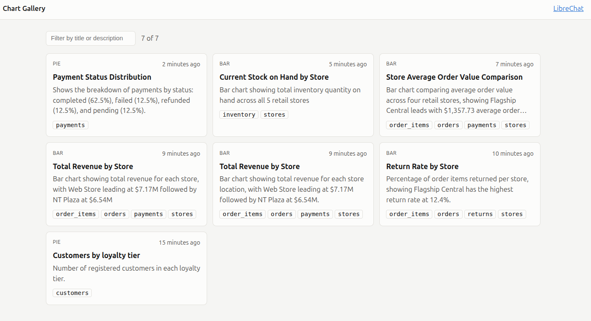
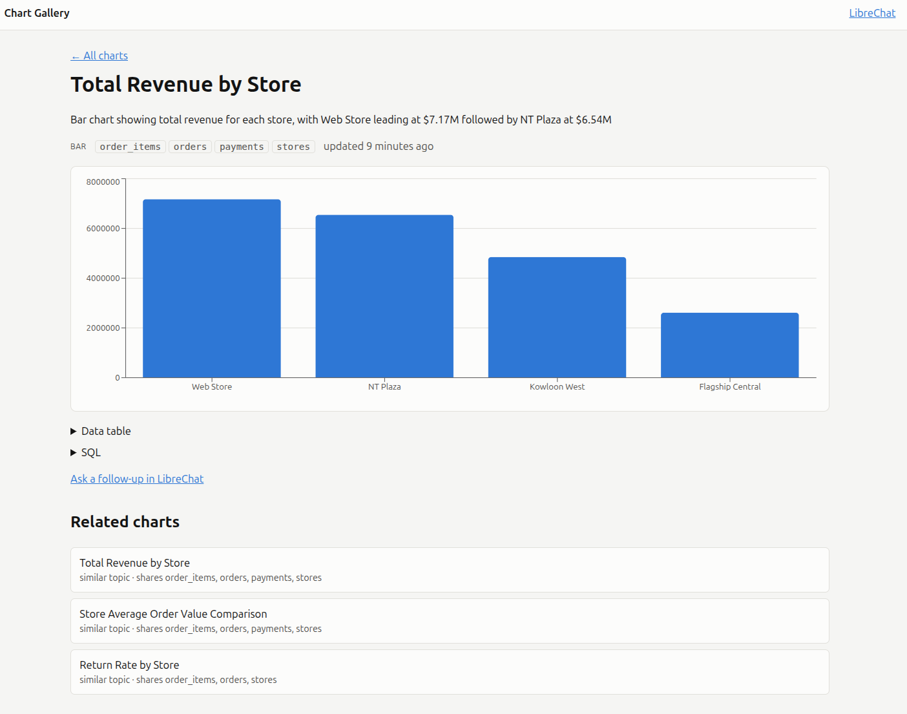

# Retail GenBI Demo — LibreChat + WrenAI MCP + SearXNG + Postgres

A self-contained, one-command demo template for an enterprise **"ChatGPT for your data"** experience:

- **Chat** — LibreChat web UI (http://localhost:3080) backed by OpenRouter models
- **Web search** — built-in search tool over a self-hosted SearXNG instance
- **Data analysis** — governed text-to-SQL over a mock 13-table retail warehouse via Wren AI's MCP server
- **Charts** — model-generated chart artifacts (recharts / HTML+Chart.js / Mermaid), opened in LibreChat's side panel
- **Chart gallery** — every chart the analyst draws is saved (http://localhost:3090) with its title, description and SQL; each chart page suggests related charts, ranked on-device by meaning



*The default **Retail Analyst** chat answering demo prompt 5. It reads the business rules, checks the schema, validates the SQL with `dry_run`, then runs it — every number comes from a real query. Search, Artifacts and the Wren tools are pre-enabled in the input bar.*



*Demo prompt 6 — MCP and web search in one answer. The analyst pulls 12-month store revenue through Wren (11 tool calls), looks up each market's official retail sales trend with web search (3 calls), and compares the two with inline citations (e.g. censtatd.gov.hk for Hong Kong). The mock warehouse has no orders for the Singapore and Taipei stores, and the analyst says so ("NO DATA available") instead of inventing numbers. It only compares the market it has real figures for.*

**Try it:** `git clone` → `./setup.sh` → open http://localhost:3080 → sign up → ask a question. Details in [Quick start](#4-quick-start).

Everything runs locally in Docker Compose. The warehouse, semantic layer and search engine stay on the box. **What does leave it:** prompts, tool calls and query results go to the LLM provider (OpenRouter), web searches go out to the engines SearXNG queries (Bing, Wikipedia, DuckDuckGo), and result pages are fetched through Keenable's public scraper. For fully offline use, point LibreChat at a local model and drop web search.

---

## 1. Background & motivation

### The business problem

Clients want ad-hoc analysis: *"Why did sales dip last March?"*, *"Which stores have the highest return rate?"*. Traditional BI requires an analyst in the loop for every question; Databricks Genie-style text-to-SQL answers them, but has two pain points:

1. **Latency** — Genie's opaque multi-step LLM pipeline commonly takes 30s+ per question, and you cannot tune the model, the prompt, or the context size.
2. **Lock-in** — the semantic definitions, feedback loop, and question history live inside the vendor's platform.

### The architectural answer

This template demonstrates the open-source equivalent, composed of four swappable layers:

| Layer | Role | Why this component |
|---|---|---|
| **Chat shell** | Conversation, model routing, tools UI, artifacts | LibreChat — multi-provider, first-class MCP + web search + artifacts |
| **Data brain** | Turns "business question" → governed SQL → rows | Wren AI — semantic layer (MDL in Git), dry-run validation, row limits |
| **World context** | External facts to complement internal data | SearXNG — self-hosted meta search, JSON API, no API keys |
| **Source of truth** | The warehouse | PostgreSQL with a realistic mock retail schema |

### Why MCP?

MCP (Model Context Protocol) is the seam that lets a chat UI call tools without custom glue code. The Wren MCP server exposes `run_sql`, `dry_run`, `get_mdl`, `describe_schema`, `get_instructions`, `recall_queries`, etc. LibreChat mounts it in `librechat.yaml` — one YAML stanza, no code. Swapping the data brain later (e.g. to Databricks Genie's API, or your own pipeline) only changes that stanza.

### Why a semantic layer instead of raw SQL access?

A raw LLM against raw tables produces wrong joins, wrong metric definitions ("revenue" means what?), and oversized result sets. Wren's MDL encodes:
- **Metric definitions** — e.g. revenue = `line_total * (1 - discount_pct/100)` for completed payments
- **Approved joins** — relationships.yml, generated from real foreign keys
- **Column semantics** — enums, units, business descriptions

This is the same architectural bet Genie makes, but the definitions live in **your Git repo**, reviewable in a pull request.

### Latency story (vs Genie)

- The MCP call uses a lean context: curated MDL models, not hundreds of raw columns
- You pick the model in LibreChat — a fast tool-calling model (e.g. `z-ai/glm-4.5-air`) makes SQL generation snappy; reserve bigger models for hard questions. The model must support tool calling, or the MCP tools never fire
- Every container is local: no cross-region round trips
- (Future work: cache frequent question→SQL pairs via Wren's memory/`recall_queries`)

### Security posture

- The Wren MCP server connects as a **read-only Postgres role** (`wren_ro`, created by `retail-db/02-readonly-role.sh`) — it physically cannot mutate data
- Every secret is generated into `.env` by `scripts/gen-env.sh` (git-ignored). The superuser (`RETAIL_DB_PASSWORD`) and read-only (`WREN_RO_PASSWORD`) passwords are separate; `wren/connection.yml` references `${WREN_RO_PASSWORD}` instead of embedding it
- Row limits + dry-run validation are built into Wren's execution path; `run_sql` defaults to 200 rows (`MCP_ROW_LIMIT`, down from wrenai's 1000)
- SearXNG is self-hosted (no search API keys), but it still forwards queries to public engines
- All published ports bind to `127.0.0.1` only
- The chart gallery write endpoint requires a bearer token (constant-time compare); its port binds to 127.0.0.1 only
- ⚠️ The Wren MCP HTTP port (7080) has **no auth** in this Wren version. It keeps the MCP SDK's DNS-rebinding protection, extended to the `wren-mcp` hostname via `MCP_ALLOWED_HOSTS` (see `wren/scripts/serve_mcp.py`). Remove the `ports:` mapping in production

---

## 2. Architecture

```
                       ┌──────────────────────────────────────┐
                       │            LibreChat :3080           │
                       │  (chat UI, agents, artifacts)        │
                       └───┬─────────────┬──────────────┬─────┘
                           │             │              │
                  OpenRouter models   web search     MCP tools
                           │             │              │
                           ▼             ▼              ▼
                  api.openrouter.ai   SearXNG :8888   Wren MCP :7080 ──save_chart──▶ chart-gallery :3090
                       (LLMs)         (meta search)   (streamable HTTP)              (FastAPI + SQLite + SPA)
                                                          │
                                                          ▼
                                              governed SQL (dry-run → run)
                                                          │
                                                          ▼
                                              retail-postgres :5432
                                              (13 tables, read-only role)
                                                          │
                                                          ▼
                                          results → model → chart artifact
                                          (recharts / Chart.js / Mermaid)
```

### Data flow for a typical question

1. User asks: *"How do monthly sales trends look over the last 12 months? Chart it."*
2. The agent (told by LibreChat's `serverInstructions`) calls `get_instructions` for the business rules in `wren/project/knowledge/rules/`, then inspects the MDL with `describe_schema` / `recall_queries`
3. It drafts SQL, validates with `dry_run`, executes with `run_sql` (read-only, row-capped)
4. It summarizes the result and emits a **chart artifact** — it appears as a card in the reply; click it to open the interactive, exportable chart in the side panel
5. It calls `save_chart`: Wren runs the SQL again (read-only, 200 rows max) and the result is stored in the chart gallery, deduplicated by normalized SQL + chart type. The reply links the gallery page.
6. Optionally it runs a parallel **web search** for market context and weaves both into the answer

### Repository layout

```
librechat-wren-demo/
├── docker-compose.yml          # 6 services, one command to boot
├── .env.example                # secrets template → copy to .env (git-ignored)
├── setup.sh                    # one-command setup: .env, build, start, verify
├── docs/
│   ├── screencap.png           # README screenshot (Wren SQL)
│   ├── screencap-2.png         # README screenshot (Wren + web search)
│   ├── screencap-3.png         # README screenshot (chart gallery list)
│   └── screencap-4.png         # README screenshot (chart detail + related charts)
├── scripts/
│   ├── lib/env.sh              # .env read/write helpers
│   ├── gen-env.sh              # generates every secret in .env
│   ├── generate-data.sh/.sql   # bulk data generator (+ test-generate-data.sh)
│   └── smoke-test.sh           # end-to-end checks against a running stack
├── retail-db/
│   ├── init.sql                # mock retail schema + seed (13 tables, 14k orders)
│   └── 02-readonly-role.sh     # creates wren_ro with SELECT-only grants
├── wren/                       # Wren MCP server image
│   ├── Dockerfile              # pip install wrenai[postgres,mcp] (pinned)
│   ├── entrypoint.sh           # wait for PG → profile → MDL build → serve MCP
│   ├── connection.yml          # read-only Postgres profile (${VAR} secrets)
│   ├── scripts/gen_mdl.py      # introspects live schema → generates MDL
│   ├── scripts/serve_mcp.py    # `wren serve mcp` with Docker-hostname Host checks
│   ├── scripts/chart_tool.py   # save_chart tool (re-runs SQL, posts to the gallery)
│   └── project/
│       ├── wren_project.yml    # Wren project manifest
│       └── knowledge/rules/    # business rules served by the get_instructions tool
├── chart-gallery/              # saved charts: FastAPI + SQLite API, React SPA, bundled embedding model
│   ├── api/gallery/            # normalize.py (dedup), repository.py, app.py
│   └── web/src/semantic/       # related-chart ranking with semantic-state (Web Worker)
├── librechat/
│   └── librechat.yaml          # endpoints, Retail Analyst model specs, web search, mcpServers
└── searxng/
    └── settings.yml            # JSON format enabled for LibreChat
```

### Chart gallery



*The gallery at http://localhost:3090 after a few analyst questions. Each card shows the chart type, the title and description the analyst wrote, and the warehouse tables its SQL reads. The two "Total Revenue by Store" cards come from two chats where the model wrote different SQL for the same question. Dedup only merges SQL that differs in whitespace, casing or comments.*



*A chart's page: the bar chart is drawn from the rows Wren re-ran, not from numbers the model typed. The data table and SQL fold out underneath. **Related charts** lists the top 3 by meaning of the title and description, with a small boost for shared tables, and each one says why it matched.*

- **Capture** — `save_chart` is an extra tool on the Wren MCP server (chart types: `line`, `bar`, `pie`, `scatter`; a scatter's x column must be numeric on every row). The model sends the title, description, chart type, SQL and field names; Wren re-runs the SQL, so the gallery never stores numbers the model typed.
- **Dedup** — the gallery normalizes SQL with sqlglot (whitespace, casing, comments) and keys charts by `sha256(normalized SQL + chart type)`. Re-asking a question refreshes the existing chart. Different aliases or a different `LIMIT` count as a new chart.
- **Related charts** — ranked in a Web Worker with [semantic-state](https://github.com/jasonli0226/semantic-state): title + description embeddings (`Xenova/all-MiniLM-L6-v2`) plus a small boost for charts that query the same tables. While the model loads, the page ranks by shared tables only. The model is baked into the gallery image and served from it; chart text never leaves the browser and no CDN is contacted.
- **Security** — writes need `CHART_GALLERY_TOKEN` (generated into `.env`); the read API and page are open but bound to `127.0.0.1`.
- **Schema changes** — there are no migrations. After a breaking change to the `charts` table, wipe the volume: `docker compose down && docker volume rm librechat-wren-demo_gallery_data`.
- **Host check** — the gallery only answers `Host` headers in `GALLERY_ALLOWED_HOSTS` (default `localhost,127.0.0.1,chart-gallery`), so a DNS-rebinding page can't read chart data.
- **Testing** — see [Testing the chart gallery](#testing-the-chart-gallery) and [Automated tests](#automated-tests).

### Dashboard builder

Turn a few saved charts into one dashboard page, at `/dashboard`.

- **Flow** — type a search in the gallery and click **Build dashboard**, or click **Build dashboard** on a chart's page to start from that chart. The page picks the charts by meaning (on-device, same model as related charts), shows them at once in a rules-based layout (note: `Arranged by rules`), then asks the API to arrange them: the most relevant chart becomes a full-width **hero** with an `AI insights` sidebar (1 to 5 short bullets), and the rest go into titled sections. Charts reach the model in relevance order with their `rank` and match `confidence`, and the prompt asks for variety (prefer line or scatter over bar, no more than two tiles of one type in a row). The hero can be a scatter chart; on a phone the hero tile and insights stack full width. If the AI answer is late (8 s), fails or doesn't validate, the rules layout stays.
- **Params** — `/dashboard?from=<chart id>` or `?q=<search>` (not both), plus `min` (minimum match score, 0 to 1, default 0.3) and `max` (most tiles, 1 to 12, default 6). Both are editable on the page; **Rebuild** re-picks and re-arranges.
- **Live data** — each tile re-runs its chart's SQL through Wren (`/api/charts/{id}/data`). If Wren is unreachable the tile shows the stored rows and says `snapshot from <time>`.
- **AI arrangement** — set `OPENROUTER_KEY` in `.env` (the same key LibreChat uses) and optionally `GALLERY_LLM_MODEL` (default `z-ai/glm-4.5-air`). Without a key the endpoint refuses and every dashboard stays rules-based. The API gives the model 7 s, under the page's 8 s wait, so an answer it pays for still arrives in time. Only chart titles, descriptions, table names, column names and headline numbers go to the model, never raw rows. The page validates the answer (every chart placed once, allowed tile types, the hero holds the first chart, numbers in insights must match the headlines) and drops insights whose numbers don't. Headlines cover every tile type a chart can take, including scatter (point count, ranges, correlation `r`).
- **Other settings** — `WREN_MCP_URL` is the Wren MCP endpoint the live-data endpoint queries (default `http://wren-mcp:7080/mcp`, the compose service). `GALLERY_PROMPT_PATH` is the file holding the arrange system prompt, read on each request (the Docker image sets it to `/app/prompts/arrange-prompt.md`, copied from `chart-gallery/web/src/dashboard/arrange-prompt.md`; no default otherwise). Running the API outside Docker without `GALLERY_PROMPT_PATH` disables AI arrangement even with `OPENROUTER_KEY` set: point it at `chart-gallery/web/src/dashboard/arrange-prompt.md`.
- **Before a demo** — warm the model: the first request after idle can take longer than the 8 s window, which silently falls back to `Arranged by rules`. Build a dashboard once beforehand, then do it live.
- **Rate limits** — in-process and per peer address: the arrange endpoint allows 6 calls per client and 30 in total per minute; the data endpoint 60 per client and 300 in total per minute. The limits key on the socket's peer address, so behind a reverse proxy every visitor shares one bucket until you add trusted `X-Forwarded-For` handling.
- **Testing** — the Playwright specs in `chart-gallery/web/e2e/dashboard.spec.ts` cover the rules path (Wren unreachable, no key) and a stubbed AI arrangement (hero, insights, phone-width stacking) and a scatter hero.

### Key design decisions

- **MDL is generated, not hand-written** — `gen_mdl.py` reads `information_schema` (tables, types, PKs, FKs) at container start. Swap `init.sql` for a client dump and the semantic layer regenerates itself. Enrich accuracy by adding entries to the `COLUMN_DOCS`/`TABLE_DOCS` dictionaries in `gen_mdl.py` (generated files are overwritten on every start).
- **Idempotent bootstrapping** — profiles are created only if missing; MDL rebuilds on every start so schema edits require just `docker compose restart wren-mcp`.
- **Preset analyst chat** — a `modelSpecs` entry in `librechat.yaml` bundles the model, an analyst system prompt, the Wren MCP server, web search and Artifacts, so users don't have to configure tools per chat.
- **Demo-mode auth** — open email sign-up (`ALLOW_REGISTRATION: "true"` in `docker-compose.yml`). For a client-facing deployment, disable registration and wire SSO/LDAP.

---

## 3. The mock retail data warehouse

13 tables with realistic volume (14k orders across 24 months — 2024-01-01 to 2025-12-31 — 900 customers, 150 products, 6 stores):

| Domain | Tables |
|---|---|
| Sales | `orders`, `order_items`, `payments`, `promotions` |
| Fulfilment | `shipments`, `returns` |
| Catalog | `products`, `product_categories`, `suppliers` |
| Ops | `stores`, `employees`, `inventory` |
| CRM | `customers` |

Orders carry realistic statuses (`pending/paid/shipped/delivered/cancelled/returned`), payments reflect cancellations and refunds, and 1 in 8 orders is returned (one item each, with a reason) — enough texture for meaningful demo questions (return-rate analysis, margin vs discount, channel effectiveness, seasonal trends).

Regenerate from scratch: `docker compose down -v && docker compose up -d --build`.

### Generating more data

`scripts/generate-data.sh` bulk-loads realistic orders into the running database. It appends by default, and adds monthly seasonality, weekend lift, volume growth, per-store return rates, and order status by age (recent orders still open):

```bash
./scripts/generate-data.sh                          # +500k orders, +20k customers (~1 min, ~300 MB)
./scripts/generate-data.sh --orders 2000000 --customers 80000
./scripts/generate-data.sh --start 2025-01-01 --end 2026-06-30 --growth 0.4
./scripts/generate-data.sh --reset                  # replace orders instead of appending (asks first)
./scripts/generate-data.sh --help
```

Same `--seed` gives identical data. The schema is unchanged, so no restart is needed. Its tests run against a throwaway container: `./scripts/test-generate-data.sh`.

---

## 4. Quick start

Needs Docker with Compose v2, `curl`, and an [OpenRouter API key](https://openrouter.ai/keys).

```bash
git clone git@github.com:jc-home-sweet-home/librechat-wren-demo.git
cd librechat-wren-demo
./setup.sh                      # asks for your OpenRouter key on first run
```

`setup.sh` checks prerequisites and free ports, creates `.env` and generates every secret, builds and starts the stack, waits until it is healthy, and runs the smoke test. It is safe to re-run: existing secrets, data and accounts are kept. Options:

```bash
OPENROUTER_KEY=sk-or-... ./setup.sh   # non-interactive (CI, remote shells)
./setup.sh --data 500000              # also load 500k extra orders on first setup
```

<details>
<summary>Manual steps (what setup.sh does)</summary>

```bash
cp .env.example .env
# edit .env → set OPENROUTER_KEY
./scripts/gen-env.sh              # fills DB passwords, SearXNG secret, LibreChat crypto/JWT secrets
docker compose up -d --build --wait
./scripts/smoke-test.sh           # PASS/FAIL for search, MDL, MCP, read-only role, LibreChat, chart gallery
```
</details>

Ports 3080, 3090, 7080 and 8888 must be free on the host (all bound to `127.0.0.1`). First boot takes a few minutes (image pulls + `wren context build`).

Then open **http://localhost:3080**:

1. Register a local account (the first account becomes admin)
2. Start a new chat with **Retail Analyst (GLM-4.6)** — the default model spec. It comes with the Wren MCP tools, web search and Artifacts (chart rendering) switched on, plus an analyst system prompt (`modelSpecs` in `librechat/librechat.yaml`)
3. Ask the demo questions below
4. Open **http://localhost:3090** to browse the saved charts and their related-chart suggestions

Raw OpenRouter models stay selectable, but they have no tools or Artifacts enabled unless you turn them on per chat.

When the model draws a chart, it shows up as a card in the reply — **click the card** to open the chart. LibreChat only auto-opens artifacts produced by its code interpreter, not ones the model writes.

### Stopping and resetting

```bash
docker compose down        # stop; keeps data and accounts
docker compose down -v     # stop and delete all data and accounts
./setup.sh                 # start again (or set up from scratch after down -v)
```

### Demo prompts (exercise all three capabilities)

| # | Prompt | What it demonstrates |
|---|---|---|
| 1 | "How do monthly sales revenue trends look over the past 12 months? Chart it." | Wren SQL → artifact chart |
| 2 | "Search the web for current consumer electronics retail trends, then compare with our top product categories." | SearXNG + Wren combined answer |
| 3 | "Which stores have the highest return rates, and which carrier ships those orders?" | Multi-join SQL → bar chart |
| 4 | "Show revenue by customer loyalty tier as a pie chart." | Single-model aggregation → chart |
| 5 | "What's our gross margin by product category?" | Uses `unit_cost` semantic definition (see screenshot above) |
| 6 | "Compare sales growth at our Hong Kong, Singapore and Taipei stores over the last 12 months with each market's official retail sales trend. Are we beating or lagging the market?" | Wren SQL + web search with cited sources; reports missing store data instead of guessing (see second screenshot above) |

### Testing the chart gallery

Ask these in a **Retail Analyst** chat. Every chart reply should end with `Saved to gallery: http://localhost:3090/charts/<id>`. The prompts come in topic clusters so the related-chart suggestions have something to find.

| Cluster | Prompts | Tables they likely share |
|---|---|---|
| A — stores | 1. "Which stores have the highest return rates? Show a bar chart."<br>2. "Show total revenue by store as a bar chart."<br>3. "Compare average order value across stores. Bar chart." | `stores`, `orders` |
| B — trends over time | 4. "How do monthly sales revenue trends look over the past 12 months? Chart it."<br>5. "Show the monthly number of orders over the last year as a line chart."<br>6. "Chart monthly revenue and monthly order count together as a line chart with two series." | `orders` |
| C — customers | 7. "Show revenue by customer loyalty tier as a pie chart."<br>8. "How many customers are in each loyalty tier? Pie chart." | `customers` |
| D — products | 9. "What's our gross margin by product category? Bar chart."<br>10. "Top 10 products by revenue, as a bar chart." | `products`, `order_items` |
| Off-topic | 11. "Show current stock on hand by store from inventory as a bar chart."<br>12. "Break down payments by payment status as a pie chart." | `inventory` / `payments` |

Then open http://localhost:3090:

- One card per chart; the filter box narrows by title and description.
- Chart 1's page lists 2 and 3 as related; chart 4 lists 5 and 6; chart 7 lists 8. Each related item says why: "similar topic" and/or "shares `stores`".
- Chart 11 may list cluster A charts (it shares `stores`), but lower down: the table boost is small next to the meaning of the title and description.
- On the first visit after a hard refresh, the related list may show "refining…" for a moment (ranked by shared tables only) until the embedding model loads from the gallery.

Edge cases:

| Prompt | Expected |
|---|---|
| Re-send prompt 1 word for word | Same gallery id (status `updated`), no duplicate card |
| Prompt 7, but ask for a bar chart | New chart: the same SQL as a different chart type is a separate chart |
| "Show revenue vs order count per store as a scatter plot." | Saved as a `scatter` chart (numeric x); with a non-numeric x, `save_chart` refuses and the reply says the chart was not saved |
| "Show daily revenue for every day in the data, line chart." | More than 200 rows → `save_chart` asks to aggregate; the model retries weekly/monthly or says it was not saved |
| "What's our total revenue this year?" | A number, no chart → nothing saved |
| "What's the capital of France?" | No SQL, no chart → nothing saved |
| "Search the web for Hong Kong retail sales trends in 2026." | Web search only → nothing saved |

To start the gallery from scratch: `docker compose down && docker volume rm librechat-wren-demo_gallery_data && docker compose up -d --wait`.

### Automated tests

```bash
# Gallery API (normalizer, repository, HTTP API, auth, Host check)
cd chart-gallery/api && uv run pytest --cov=gallery

# Gallery web app (rendering, pages, related-chart ranking)
cd chart-gallery/web && npm ci && npm test && npm run build

# save_chart tool
uv run --no-project --with pytest --with httpx --with "mcp<2" pytest wren/tests

# Browser E2E: starts its own throwaway gallery on :3091 with a fresh database
# (the compose stack's gallery is never touched; seeds use made-up numbers)
cd chart-gallery/web && npx playwright install chromium && npm run e2e

# Whole running stack, including the gallery and save_chart registration
./scripts/smoke-test.sh
```

### Verifying services individually

`./scripts/smoke-test.sh` checks everything at once. To poke at each service by hand:

```bash
# SearXNG JSON API
curl -s "http://localhost:8888/search?q=retail+trends&format=json" | head -c 300

# Wren MCP handshake (expect server capabilities in the response)
curl -s http://localhost:7080/mcp -X POST \
  -H 'content-type: application/json' -H 'accept: application/json, text/event-stream' \
  -d '{"jsonrpc":"2.0","id":1,"method":"initialize","params":{"protocolVersion":"2025-03-26","capabilities":{},"clientInfo":{"name":"curl","version":"0"}}}'

# LibreChat health
curl -s http://localhost:3080/health

# Chart gallery: health and saved charts
curl -s http://localhost:3090/healthz
curl -s http://localhost:3090/api/charts | head -c 300
```

> If the MCP handshake 404s, check the path printed in the `wren-mcp` container banner at startup (`docker compose logs wren-mcp`) and mirror it in `librechat/librechat.yaml`. A `421 Misdirected Request` means the Host header isn't in `MCP_ALLOWED_HOSTS`.

---

## 5. Customizing for a client

1. **Swap the data** — replace `retail-db/init.sql` with the client's schema/dump, or point `wren/connection.yml` at their real warehouse (read-only credentials!). Restart `wren-mcp`; the MDL regenerates automatically.
2. **Enrich the semantic layer** — add business descriptions, metric definitions, and enums in the `gen_mdl.py` dictionaries. Hand-edits to `wren/project/models/*` are overwritten on every start, so put durable changes in `gen_mdl.py`. This is the single biggest accuracy lever.
3. **Business rules** — edit `wren/project/knowledge/rules/*.md` (revenue formula, date semantics, chart-type selection policy). Served by Wren's `get_instructions` tool; LibreChat's `serverInstructions` tells the agent to call it first.
4. **Models** — edit the OpenRouter model list in `librechat/librechat.yaml` (tool-calling models only). Image and `wrenai` versions are pinned; bump them deliberately.
5. **Different data source** — Wren supports 20+ connectors (MySQL, BigQuery, Snowflake, ClickHouse, Databricks, Trino…). Change the `wrenai[...]` extra + `connection.yml` fields (`wren docs connection-info <ds>` prints the exact schema).

## 6. Troubleshooting

| Symptom | Check |
|---|---|
| `setup.sh` stops early | It prints the failing step: Docker not running, a port in use, a missing/invalid OpenRouter key, or a service that never became healthy (`docker compose ps`, `docker compose logs <service>`) |
| No "Sign up" link | `ALLOW_REGISTRATION` must be `"true"` for the `librechat` service; then `docker compose up -d librechat` |
| `wren-mcp` restart-looping | `docker compose logs wren-mcp` — usually PG not ready, `WREN_RO_PASSWORD` unset, or `gen_mdl` seeing no tables (role grants) |
| MCP tools missing in LibreChat | LibreChat only connects at startup (compose waits for the `wren-mcp` healthcheck) → `docker compose restart librechat`; a 421 in `wren-mcp` logs means a Host-header mismatch |
| Search returns nothing | Engines in `librechat.yaml` `searxngSearchOptions` must be enabled in `searxng/settings.yml`; DuckDuckGo often CAPTCHAs self-hosted instances. Test `curl :8888/search?...&format=json` |
| SQL errors mid-chat | Read the structured error hint the agent receives; adjust `knowledge/rules/*.md` rather than only re-prompting |
| Chart card appears but no chart | Click the card — model-written artifacts don't auto-open. The preview loads CodeSandbox's bundler in your browser, so it needs internet access |
| Charts not rendering / ASCII charts | Use a **Retail Analyst** model spec (Artifacts preset on). Chats started on a raw model, or before a config change, keep their old settings — start a new chat |
| Chart drawn but no "Saved to gallery" link | Check the reply's tool calls for `save_chart`. Missing → `docker compose restart librechat` (it loads MCP tools at startup) and start a new chat; present with `saved: false` → the error says what to fix (unsupported chart type, unknown column, >200 rows) |
| `save_chart` says "cannot reach the chart gallery" | `docker compose ps chart-gallery`, `docker compose logs chart-gallery`; `CHART_GALLERY_TOKEN` must be the same for `wren-mcp` and `chart-gallery` (both read it from `.env`) |
| Gallery answers `400 Invalid host header` | Open it as `http://localhost:3090` or `http://127.0.0.1:3090`, or add the host to `GALLERY_ALLOWED_HOSTS` |
| Related charts stay on "refining…" | The embedding model didn't load: check the browser console for 404s under `/models/` or `/ort/` and rebuild the image (`docker compose up -d --build chart-gallery`). The table-overlap ranking keeps working meanwhile |
| `npm run e2e` says "refusing to seed made-up charts" | E2E pointed at a gallery that already has charts; run it through `npm run e2e` (it starts its own gallery on :3091) |
| Model quotes numbers it never queried | The analyst prompt forbids it; if it persists, switch spec (GLM-4.6 follows tool rules more reliably) and check the reply's tool calls |

## 7. Known caveats

- Wren MCP runs in **Interactive Mode only** (no agentic planning loop over MCP).
- No auth on the MCP HTTP port (see Security posture) — don't expose 7080 publicly.
- `wren serve mcp` never auto-rebuilds a stale MDL — after editing models, restart the container.
- LibreChat email registration is open (`ALLOW_REGISTRATION: "true"`, demo convenience) — set it to `"false"` once your account exists, and before exposing anything publicly.
- Chart artifacts open on click, not automatically (LibreChat v0.8.8 behaviour for model-written artifacts).
- WrenAI moves fast (CLI-first since v0.8). `wren/Dockerfile` pins `wrenai==0.15.0` and `mcp<2` (wrenai 0.15 imports `FastMCP`, which mcp 2.x renamed). `serve_mcp.py` patches a Host-header bug and can go once upstream fixes it.
- The chart gallery's read API and pages have no login: anyone who can reach `127.0.0.1:3090` sees every saved chart. Only writes need the token.
- The LibreChat footer's "Chart gallery" link (`CUSTOM_FOOTER`) shows only for signed-in users.
- The gallery's first page load downloads the ~23 MB embedding model from the gallery itself (then browser-cached). The list page starts it too, as a warm-up for the related-chart suggestions.
- `product_categories.parent_id` (self-referencing FK) is not modelled as a relationship; hierarchy queries need hand-written self-joins.

## 8. References

- Wren AI: https://github.com/Canner/WrenAI · docs: https://docs.getwren.ai (MCP guide: `/oss/guides/mcp`)
- LibreChat: https://github.com/danny-avila/LibreChat · MCP config: https://www.librechat.ai/docs/configuration/librechat_yaml/object_structure/mcp_servers
- SearXNG: https://docs.searxng.org
- Background on the design space: Databricks Genie (text-to-SQL), Claude Artifacts pattern, BIRD/Spider text-to-SQL benchmarks
